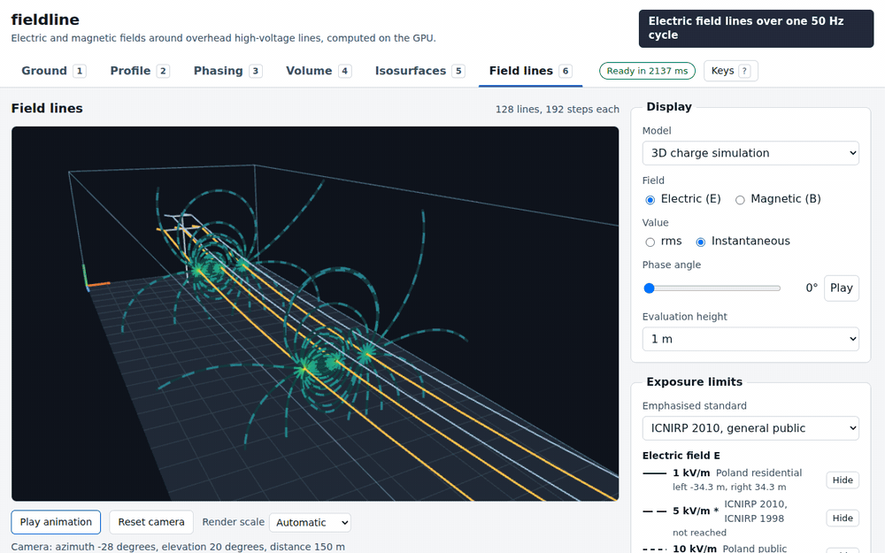
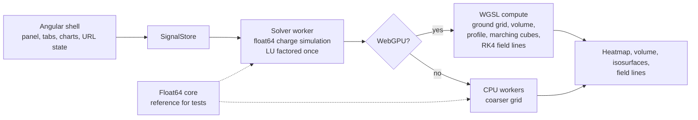

# fieldline

GPU-computed real-time 3D visualization of the electric and magnetic fields near overhead high-voltage lines, with exposure contours, lateral profiles and a phase-arrangement optimizer. Built with WebGPU.



The recording is made by `pnpm record:demo`, which drives the production build in Chromium on the software WebGPU adapter (SwiftShader). Live demo: https://fieldline.adrianturbinski.pl/

[](https://github.com/adiyy2001/fieldline/actions/workflows/ci.yml)


[](LICENSE)

The two coverage badges are static and come from `pnpm test:coverage` (see the table under Tests). `pnpm check:readme` fails when the coverage table, the badges, the solve table or the GPU error table in this file differ from the stored results, and CI runs it after the coverage step.

## Why I built this

I work on software for high-voltage substations, and one question that keeps coming up is how strong the field under a line is when the line passes near houses. I wanted to calculate it properly, see its 3D shape and check the numbers against analytic solutions rather than trust a picture.

It's also a serious WebGPU compute project. Field evaluation, marching cubes and the field line tracer are compute passes, and a float64 TypeScript implementation of the same math is the reference they are tested against.

## What is hard about it

- A 3D field from a hanging conductor. Conductors are catenaries, so the line is not a set of infinite parallel wires. Each conductor is cut into straight segments with uniform charge, the charges follow from matching the potential at one collocation point per segment, and the field comes from closed-form expressions for finite segments and their ground images. The matrix depends on the geometry only, so it is factored once with a real LU and every change of voltage, angle or phasing reuses the factors.
- Singularities at the conductor. The distance to the axis is clamped to the conductor radius, so the field is finite and continuous on the surface. The same rule runs in the 2D model, the 3D model, the GPU kernels and the field line tracer.
- Float32 on the GPU. A coordinate 450 m from the origin has a float32 spacing of 3e-5 m, which is 0.02 percent of the clamp radius. Segment ends and evaluation points are subtracted from the centre of the region in float64 on the CPU, and only the differences go to the shaders. Without that, the error next to a conductor would be visible.
- Knowing the numbers are right. Every layer is checked against something outside itself: the analytic solution of a conductor above ground, the 2D model that the 3D result must approach as the span grows, mirrored phasing, a published study of limit heights, and the float64 code for the GPU.
- Ranking phase arrangements. The 36 arrangements of a double circuit fall into 6 symmetry classes. Because the solve produces basis charges per phase position, each class is evaluated from the basis with no new factorization, and the optimizer explains the winner through the dipole moments that cancel.

## How it works



The core in `src/core` has no framework and no DOM. It holds the catenary geometry, the 2D and 3D models, the optimizer, exposure levels and the validation code. `src/gpu` holds raw WebGPU, with no three.js (ADR 6). `src/app` is the Angular shell: standalone components, signals, a SignalStore, zoneless change detection and the whole configuration in the URL so a link reproduces a view.

The 2D cross-section model uses the Maxwell potential coefficients and solves for complex charges from the voltages:

$$P_{ij} = \frac{1}{2\pi\varepsilon_0}\ln\frac{D'_{ij}}{D_{ij}}, \qquad P_{ii} = \frac{1}{2\pi\varepsilon_0}\ln\frac{2h_i}{r_{eq,i}}, \qquad \mathbf{Q} = \mathbf{P}^{-1}\mathbf{V}$$

with the bundle radius $r_{eq} = \left(n\,r\,A^{n-1}\right)^{1/n}$. The 3D model cuts every conductor into segments and solves

$$\sum_{j=1}^{N} P_{ij}\,\lambda_j = V_i, \qquad P_{ij} = \varphi_{unit}(M_i;\ \text{segment } j) - \varphi_{unit}(M_i;\ \text{image of segment } j)$$

where the potential of a uniform segment of length $\ell$ is

$$\varphi = \frac{\lambda}{4\pi\varepsilon_0}\left[\operatorname{asinh}\frac{\ell - t}{\rho} + \operatorname{asinh}\frac{t}{\rho}\right]$$

and the field is $\mathbf{E} = \frac{\lambda}{4\pi\varepsilon_0}\left[k\,\hat{\rho} + \left(\frac{1}{R_2} - \frac{1}{R_1}\right)\hat{u}\right]$. The magnetic field is Biot-Savart over the same segments. Every equation has its derivation and its tests in [docs/physics.md](docs/physics.md).

The app has six views: ground heatmap with contours, lateral profile with a data table and CSV export, the phasing optimizer, volume ray marching, isosurfaces from a compute marching-cubes pass, and field lines traced with RK4 in a compute shader and animated over the cycle. Contours default to the ICNIRP 2010 general public levels at 50 Hz, with presets for the 1998 levels and the Polish limits and room for custom levels (ADR 11).

## Validation and benchmarks

Every number below is printed by a script in this repository, and `pnpm report` prints all of the tables in this section from the stored result files. The files in `bench/results/` name the host, browser, adapter and commit.

**Machine.** Intel Core i7-12700H (20 logical CPUs), Linux 6.6.87.2 under WSL2, Node 24.21.0, run on 2026-10-11. Every result file except the Lighthouse one records the commit it was measured at: the real GPU files at 11ab67e, the software 3D scene file at bf47569 and the other software and CPU files at ccde471. Between those commits only the interface, the URL angle rounding and an automation-only draft grid switch changed, none of which the timing files exercise. Software numbers (SwiftShader, the CPU backend) come from Chromium 156.0.8078.4 on that machine. Real GPU numbers come from the Windows host of the same laptop, through headless Chrome 154.0.8037.98 with the production build served from WSL: an NVIDIA GeForce RTX 3070 Ti Laptop GPU (Ampere) and an Intel Iris Xe (Gen 12LP). No mid-range desktop GPU was measured, so I make no claim about one.

### Validation of the physics

`pnpm validate:physics` and `pnpm plot:convergence`.

| Check                                                                             | Result                                                                                                      |
| --------------------------------------------------------------------------------- | ----------------------------------------------------------------------------------------------------------- |
| E of a line charge, E above ground, potential at scattered points                 | relative error 1.2e-16 to 4.0e-16                                                                           |
| B of a long conductor against μ0·I/(2πr)                                          | 1.3e-10                                                                                                     |
| Equivalent radius of three 30.2 mm subconductors at 0.4 m (0.1342 m in the paper) | 1.2e-4                                                                                                      |
| Equivalent conductor against explicit subconductors                               | limit heights move by at most 0.009 m                                                                       |
| 14 limit heights of a published 420 kV study                                      | 13 reproduced 0.014 to 0.028 m below the published value (mean 0.022 m), one case fitted and marked as such |
| Ranking of phase arrangements against the paper                                   | 0 violations                                                                                                |

The published reference is Bendík, Cenký and Eleschová, Electricity 2026, 7(2), 39 (https://doi.org/10.3390/electricity7020039, CC BY 4.0). It covers mid-span clearance heights in a 2D model. I found no openly published 3D profile of a standard configuration, so the 3D model has no published reference, and the 3D checks are the convergence to 2D and the analytic cases. The deviation to the paper has the same sign in all cases and I could not isolate its cause (see the limits below).


### Convergence of 3D to 2D

Peak field at mid-span of the 3D charge simulation divided by the 2D cross-section, default spans:

| Tower                      | E, 3D over 2D | B, 3D over 2D |
| -------------------------- | ------------- | ------------- |
| Single circuit, horizontal | 0.9936        | 0.9873        |
| Single circuit, delta      | 0.9952        | 0.9884        |
| Double circuit, stacked    | 0.9972        | 0.9890        |

For a straight line with a span of 800 m the ratios are 0.999999 for E and 0.999972 for B. Twelve segments per span differ from 48 by 0.36 percent in E and in B. The potential residual at the conductor surface is 0.27 to 0.42 percent inside the spans and up to 1.8 percent where the conductor kinks at a tower (ADR 21).


### Float32 on the GPU against float64

`pnpm bench:gpu` evaluates ground grids, volumes, profiles and a probe that starts on a conductor axis, on three towers, and compares with the float64 code. The maximum relative error is worst in the clamp zone and below 2.1e-4 on the ground grid and the volume.

| Adapter                   | Max error E | Max error B | Max mirror difference |
| ------------------------- | ----------- | ----------- | --------------------- |
| SwiftShader (software)    | 6.5e-4      | 1.6e-4      | 3.0e-5                |
| Intel Iris Xe             | 6.5e-4      | 1.6e-4      | 3.1e-5                |
| NVIDIA RTX 3070 Ti Laptop | 6.5e-4      | 1.5e-4      | 3.4e-5                |

The target was 1e-3, and it holds with a factor of 1.5 inside the clamp zone and with a much larger margin elsewhere (physics.md, sections 15 and 16).

### Charge solve

`pnpm bench:solve`, Node 24.21.0 on the machine above, 12 segments per span. Assembly, LU factorization and the basis solves together:

| Tower          | Unknowns | Time (ms) |
| -------------- | -------- | --------- |
| Horizontal     | 210      | 10.0      |
| Double circuit | 336      | 30.8      |

### Update latency

`pnpm bench:latency` times a parameter change from the call to the published frame and the next render, through the automation hook. Median and p95 in ms; the target is a median under 200 ms. Geometry changes sweep 40 distinct sag values so the solve cache never hits.

| Case                                     | NVIDIA RTX 3070 Ti Laptop | Intel Iris Xe | CPU backend (software) | SwiftShader (software) |
| ---------------------------------------- | ------------------------- | ------------- | ---------------------- | ---------------------- |
| Horizontal, geometry change              | 50 / 60                   | 75 / 83       | 263 / 299              | 1316 / 1669            |
| Horizontal, geometry drag, draft quality | 49 / 56                   | 55 / 59       | 75 / 78                | 251 / 400              |
| Horizontal, voltage change               | 38 / 60                   | 65 / 73       | 241 / 301              | 1092 / 1598            |
| Double circuit, geometry change          | 124 / 141                 | 121 / 147     | 411 / 500              | 1628 / 1973            |
| Double circuit, voltage change           | 45 / 54                   | 114 / 138     | 416 / 469              | 1615 / 2026            |
| Double circuit, phasing change           | 65 / 80                   | 98 / 123      | 429 / 476              | 1610 / 2002            |

Both real GPUs meet the target in every case. The CPU fallback does not, except for the draft quality drag, and the software WebGPU adapter is only a correctness tool.

### Frame times

`pnpm bench:fps` records the interval between 300 `requestAnimationFrame` callbacks per view at 1920 by 1080 (30 frames on the software adapter). On both real GPUs the median sits at 8 ms for almost every view, with a p95 below 9 ms. That is the frame clock of the headless browser, which I did not measure separately, so the table shows that those views fit inside it and says nothing about how much faster they could run. The only view that does not is the electric field lines on the Iris Xe.

| View                      | NVIDIA RTX 3070 Ti Laptop | Intel Iris Xe | SwiftShader (software) |
| ------------------------- | ------------------------- | ------------- | ---------------------- |
| Ground, instantaneous     | 126.6 fps                 | 128.2 fps     | 30.0 fps               |
| Volume, instantaneous     | 128.2 fps                 | 129.9 fps     | 7.5 fps                |
| Volume, rms, orbiting     | 129.9 fps                 | 128.2 fps     | 7.5 fps                |
| Isosurface of E, orbiting | 126.6 fps                 | 129.9 fps     | 59.9 fps               |
| Isosurface of B, orbiting | 128.2 fps                 | 128.2 fps     | 59.9 fps               |
| Field lines of E          | 128.2 fps                 | 64.9 fps      | 0.6 fps                |
| Field lines of B          | 129.9 fps                 | 125.0 fps     | 0.6 fps                |

The slowest real case is the electric field lines on the Iris Xe, at 15.6 ms (64 fps). On software rendering the 3D views are slow, which is why an automatic render scale steps the 3D views down when the median frame time stays above 20 ms (ADR 23).

### Lighthouse

`pnpm lighthouse` runs Lighthouse 13.5.0 on the production build in Chromium 156 with the WebGPU renderer and with the CPU fallback, on mobile and desktop emulation.

| Renderer     | Form factor | Accessibility | Best practices | SEO | Performance |
| ------------ | ----------- | ------------- | -------------- | --- | ----------- |
| WebGPU       | mobile      | 1             | 1              | 1   | 0.89        |
| WebGPU       | desktop     | 1             | 1              | 1   | 0.76        |
| CPU fallback | mobile      | 1             | 1              | 1   | 0.93        |
| CPU fallback | desktop     | 1             | 1              | 1   | 1           |

The WebGPU runs use the software adapter, so the performance score reflects a lab run without a GPU. The initial bundle is 367 kB raw, 101 kB transferred.

## Run it locally

You need Node 24.15 or newer and pnpm, which `corepack enable` provides.

```sh
pnpm install
pnpm start
```

Open http://127.0.0.1:4330. WebGPU needs a recent Chrome or Edge (113 or newer on Windows, macOS and ChromeOS, 144 or newer on Linux with an Intel Gen 12 or newer GPU). Without it the app falls back to the CPU path with a coarser grid and says so in the status line. Add `?automation` to the URL to expose the hook described in [docs/automation.md](docs/automation.md).

To rebuild the numbers and the demo:

```sh
pnpm bench:gpu && pnpm bench:latency && pnpm bench:fps
pnpm validate:physics && pnpm plot:convergence && pnpm bench:solve
pnpm lighthouse
pnpm report
pnpm record:demo
```

The GPU benchmarks accept `--channel chrome --real-gpu` to run on the real GPU of the machine, and `--emit-script` with `--ingest` to run the in-page part on another host. `pnpm record:demo` needs `ffmpeg`.

## Tests

`pnpm verify` runs format check, lint, a style check, type checks, unit tests with coverage, a production build and the end-to-end suite. It passed on this machine with 902 unit tests in 104 files, 90 script tests and 108 end-to-end tests, and in a fresh clone inside a Node 24 container limited to 2 CPUs.

| Layer                              | Lines covered | Percent |
| ---------------------------------- | ------------- | ------- |
| src/core (math, models, optimizer) | 2410 of 2426  | 99.3    |
| src/gpu                            | 358 of 358    | 100.0   |
| src/workers                        | 32 of 32      | 100.0   |
| src/app                            | 1669 of 2031  | 82.2    |

Thresholds are 90 percent of lines for the core and 80 percent for the rest. A short list of files that need a real device is excluded, with the reasons in ADR 15.

- Unit tests (Vitest through the Angular builder) check the math against the analytic cases, plus fast-check properties for symmetry and superposition.
- The integration layer is the store, pipeline and service specs under `src/app`, which run the real store against an inline solver and the CPU executor, and the Playwright parity specs, which run the real shaders against the float64 code in the production build. CI names the two steps "Unit and integration tests with coverage" and "End-to-end tests".
- Playwright runs a `gpu` project against the production build with the SwiftShader adapter and a `cpu` project without WebGPU. They compare GPU and CPU fields, check the views, the keyboard paths, the fallback after a lost device, and screenshots of every view. The single-key shortcuts (digits, Space, brackets, E, B, R and ?) can be turned off in the help dialog, as WCAG 2.1.4 asks, and the choice is kept in the browser.
- `pnpm test` runs unit tests, `pnpm test:coverage` adds coverage, `pnpm e2e` builds and runs Playwright (first run `pnpm exec playwright install chromium`).
- CI runs the same steps and Lighthouse. I could not dry-run the workflow with `act` because it is not installed here, so I ran a fresh clone with `pnpm install`, `pnpm start` and `pnpm verify` in a clean Node 24 container instead.

## Design decisions

The full list is in [docs/adr](docs/adr). The ones that shaped the project most:

- [1](docs/adr/0001-angular-shell-with-framework-free-core.md) Angular shell around a framework-free core.
- [2](docs/adr/0002-charge-simulation-with-a-real-lu-factored-once.md) Charge simulation with a real LU factored once.
- [5](docs/adr/0005-phasing-optimizer-symmetry-classes-and-moments.md) The optimizer works on symmetry classes and explains the winner with moments.
- [6](docs/adr/0006-raw-webgpu-no-threejs.md) Raw WebGPU instead of three.js, with the measured bundle size of both.
- [7](docs/adr/0007-gpu-field-kernel-layout.md) and [22](docs/adr/0022-field-backends-and-gpu-evaluation.md) The kernel layout and the backends.
- [14](docs/adr/0014-frame-capture-by-readback-and-the-automation-hook.md) Frame capture by readback and the automation hook.
- [17](docs/adr/0017-validation-against-a-published-reference.md) Validation against a published reference, with the fitted case marked.
- [19](docs/adr/0019-scope-of-the-electromagnetic-model.md) What the model includes and what it leaves out.
- [21](docs/adr/0021-accuracy-of-the-charge-system.md) How the accuracy of the charge system is measured and reported.
- [23](docs/adr/0023-performance-pass-solve-cache-and-render-scale.md) The performance pass that took updates from about 400 ms to under 70 ms on the RTX.
- [25](docs/adr/0025-stretch-goals-left-out.md) Stretch goals left out, and why.

## Limitations and what I would do next

- Earth return and shield wire currents are ignored. Balanced currents leave no net return, and the estimate for an unbalanced remainder is 0.2 µT at the ground for a full 1000 A (ADR 19). Currents induced in the shield wires would lower B a little, so leaving them out errs high. Deri's complex image would be the next step for earth return.
- One line, flat ground. Two parallel lines in a corridor and sloped terrain are not built. The first needs its own solve measurements, the second breaks the image method (ADR 25).
- No 3D published reference. The published study covers 2D clearance heights. Its limit heights are 0.014 to 0.028 m above mine in every case, and I did not isolate the cause.
- Charge discretization. The potential residual is up to 1.8 percent where a conductor kinks at a tower. The field converges faster than the surface potential (0.36 percent between 12 and 48 segments), but shorter segments next to the towers would reduce the residual.
- GPU accuracy in the clamp zone. 6.5e-4 is under the 1e-3 target with a factor of 1.5. Outside the clamp zone it is below 1.2e-4. Very large grids would need one origin per tile.
- CPU fallback is slower than the target. Full quality updates take 263 to 429 ms on the CPU backend (median). Only the draft drag is under 200 ms.
- Measured on one laptop. Two real GPUs (a high-end laptop part and an integrated one) on the same machine, one browser engine (Chromium). Firefox and Safari were not tested. I would like numbers from a mid-range discrete GPU.
- Lighthouse performance is 0.76 to 1, and it moves by about 0.1 between runs on the same build. The lab score comes from the software adapter. The best practices score was 0.96 before I fixed the tower marks of the ground view, which had a negative height and logged a console error, and the marks were never drawn.
- The GPU contour dashes follow the dominant axis of the gradient. On very steep contours the dash length is not exactly constant (ADR 24).

## Credits and licence

Third-party packages, the published reference and the viridis colours are listed with their licences in [CREDITS.md](CREDITS.md). The code is released under the MIT licence, see [LICENSE](LICENSE).
