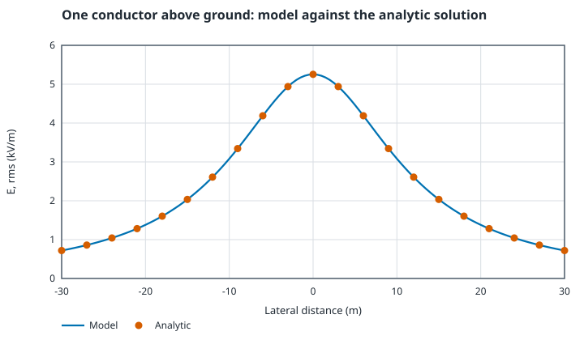
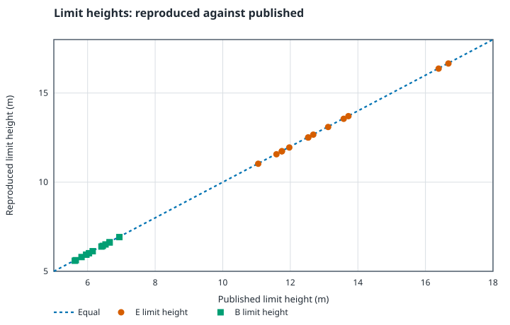
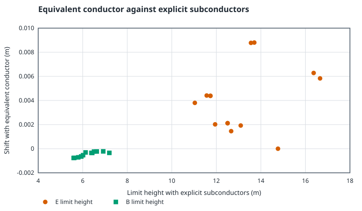
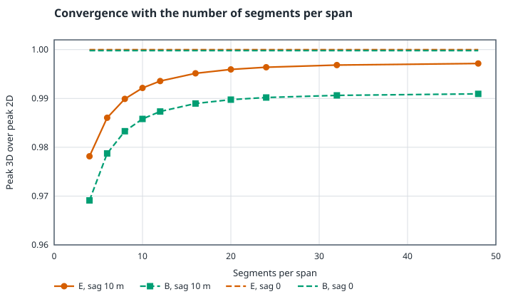
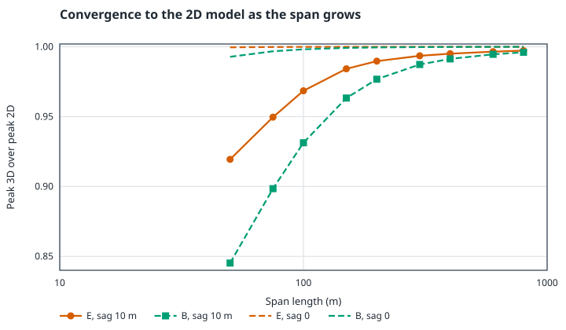
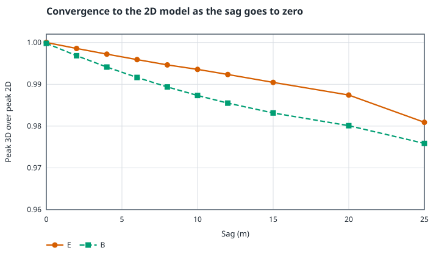

# Physics of fieldline

This file derives every equation the field model uses and points each one at the test that checks it. Part 1 (sections 1 to 5) covers conventions, phasors, the 2D cross-section model, exposure levels, the phasing optimizer and the validation of the 2D model. Part 2 (sections 6 to 12) covers the 3D charge simulation and its convergence to the 2D model. Part 3 (sections 13 to 16) covers the float32 evaluation on the GPU and its measured error.

Test paths are relative to `src/core`. A test is named by the file and the wording of its `it(...)` description.

## 1. Conventions

### Coordinates and units

The x axis points sideways across the line, y points up and z runs along the line. The ground is the plane y = 0. All values in the core are SI: metres, volts, amperes, tesla, volts per metre. The interface converts to kV/m and µT for display.

Constants are the CODATA 2022 values:

$$\varepsilon_0 = 8.8541878188 \times 10^{-12}\ \text{F/m}, \qquad \mu_0 = 1.25663706127 \times 10^{-6}\ \text{N/A}^2$$

Check: `constants.spec.ts`, "uses the CODATA 2022 values", plus the derived values of the Coulomb constant (8987.55 V·m per µC) and of μ0/4π (9.99999999868e-8).

### Phasors

The model is quasi-static at one angular frequency ω = 2π·50 Hz. At 50 Hz the wavelength is 6000 km, so the electric field follows the charges at each instant and the magnetic field follows the currents at each instant (ADR 19).

A sinusoidal quantity is the real part of a rotating complex number. A phasor F holds its rms value and its phase, and the instantaneous value at the angle θ = ωt is

$$f(\theta) = \sqrt{2}\,\mathrm{Re}\left[F e^{j\theta}\right]$$

The three phase voltages are the line to line voltage divided by √3, at 0, -120 and +120 degrees:

$$V_a = \frac{V_{LL}}{\sqrt{3}}, \qquad V_b = V_a e^{-j2\pi/3}, \qquad V_c = V_a e^{+j2\pi/3}$$

The three sum to zero. A current of magnitude I at power factor angle φ (lagging) has the angle of its phase voltage minus φ:

$$I_k = I\, e^{\,j(\theta_k - \varphi)}$$

Checks: `phasor.spec.ts`, "gives phase voltages of V_LL over root three at 0, -120 and +120 degrees", "subtracts the power factor angle from the voltage angle for a lagging current", "sums the three voltages to zero".

### Resultant rms value

At a point, E and B are vectors of three complex phasors (F_x, F_y, F_z). The instantaneous vector is f_k(θ) = √2 Re[F_k e^{jθ}]. Write z = F_k e^{jθ}. Then

$$f_k^2 = \tfrac{1}{2}(z + \bar z)^2 = |F_k|^2 + \mathrm{Re}\left[F_k^2 e^{2j\theta}\right]$$

The second term averages to zero over a cycle, so the mean square of the vector magnitude is the sum of the squared phasor magnitudes. The resultant rms value is

$$F_{rms} = \sqrt{\sum_k |F_k|^2}$$

This is the value that reference levels apply to. Check: `phasor.spec.ts`, "uses the root of the summed squared magnitudes as the resultant rms" and "gives a mean square over the cycle equal to the squared rms".

Summing over the three components gives the magnitude over the cycle:

$$|f(\theta)|^2 = N + \mathrm{Re}\left[S\, e^{2j\theta}\right], \qquad N = \sum_k |F_k|^2, \quad S = \sum_k F_k^2$$

The vector traces an ellipse. Its semi-major axis is √(N + |S|) and its semi-minor axis is √(N − |S|). The ellipse is a line when the components are in phase, and a circle when S = 0. In a circle the magnitude stays constant over the cycle. Checks: `phasor.spec.ts`, "collapses to a line for a linearly polarized phasor", "is a circle for equal quadrature components", "matches the maximum of the instantaneous magnitude over the cycle", "keeps the magnitude of a circularly polarized field constant over the cycle".

The instantaneous view in the application shows f(θ) at a chosen θ. Check: "evaluates the real part at omega t of 0 and 90 degrees by hand".

## 2. The 2D cross-section model

At mid-span a conductor is far from the towers compared with its height above ground. The 2D model replaces it with an infinite straight line at the mid-span height. Each conductor becomes a point (x_i, y_i) in the cross-section with radius r_i, carrying a line charge q_i per metre and a current I_i. The ground is a perfect conductor at zero potential.

### Potential of a line charge and its image

A line charge q in free space gives a potential φ(ρ) = −q/(2πε0)·ln ρ plus a constant, where ρ is the distance from the line. This follows from Gauss's law: the field is radial with magnitude q/(2πε0 ρ), and the potential is minus its integral.

A perfect conductor at y = 0 sets φ = 0 on that plane. An image charge −q at (x_c, −y_c) does this: every point of the plane is equally far from the charge and from its image, so the two logarithms cancel. With D the distance to the charge and D' the distance to the image,

$$\varphi(x, y) = \frac{q}{2\pi\varepsilon_0}\,\ln\frac{D'}{D}$$

Check: `field2d/field.spec.ts`, "holds the conductor voltage on its surface and zero on the ground", "matches the analytic field and potential at scattered points". The scattered points test compares the model with the closed form in `validation/analytic.ts`.

### Maxwell potential coefficients

With n conductors the potential at conductor i is the sum of the contributions of all charges and their images:

$$V_i = \sum_j P_{ij}\, q_j$$

On its own surface (distance r_i from its axis) conductor i sees its image at distance 2h_i. Between two conductors the distance D_ij is measured to the other axis and D'_ij to its image:

$$P_{ii} = \frac{1}{2\pi\varepsilon_0}\ln\frac{2h_i}{r_i}, \qquad P_{ij} = \frac{1}{2\pi\varepsilon_0}\ln\frac{D'_{ij}}{D_{ij}}$$

The matrix is real and symmetric. The conductors are at their phase voltages and the shield wires at 0 V, so the charges follow from

$$Q = P^{-1} V$$

Checks: `field2d/solver.spec.ts`, "uses ln(2h/r) for the self term", "uses ln(D prime over D) for the mutual term and is symmetric", "assembles a symmetric matrix with positive entries". `field2d/field.spec.ts`, "reproduces each phase voltage at its conductor and zero at the shield wires" and "induces charge on the shield wires of the opposite sign to the nearest phase".

One factorization of P is enough for every voltage set. Because P is real, the solve runs once per phase group with a unit voltage, and the charges for any complex voltage set are the linear combination Q = Σ_g V_g Q_g (ADR 2). Checks: `field2d/solver.spec.ts`, "combines basis charges linearly into complex charges"; `field2d/field.spec.ts`, "is linear in the voltage phasors"; `linear/lu.spec.ts` for the solver itself.

Two wires closer than the larger of their radii would give a logarithm of a number below one or a singular matrix, so the distance is clamped to the larger radius. Check: `field2d/solver.spec.ts`, "clamps the distance of overlapping wires to the larger radius".

### Bundle equivalent radius

A bundle has n subconductors of radius r on a circle of radius A, with spacing a between neighbours. Elementary geometry of the regular polygon gives

$$A = \frac{a}{2\sin(\pi/n)}$$

Treat the bundle as one conductor with total charge Q, so each subconductor carries q = Q/n. The subconductors are close to each other compared with their height, so the image of every subconductor is at about the same distance 2h. At subconductor 1 the potential is

$$V = \frac{q}{2\pi\varepsilon_0}\left[\ln\frac{2h}{r} + \sum_{k=2}^{n}\ln\frac{2h}{d_{1k}}\right] = \frac{q}{2\pi\varepsilon_0}\left[n\ln(2h) - \ln\left(r\prod_{k=2}^{n} d_{1k}\right)\right]$$

where d_1k are the distances from subconductor 1 to the others. For a regular n-gon with circumradius A, the product of the distances from one vertex to the other n − 1 vertices is n·A^{n−1}. This is the modulus of the derivative of z^n − A^n at a root. Then

$$V = \frac{nq}{2\pi\varepsilon_0}\ln\frac{2h}{\left(n\, r\, A^{n-1}\right)^{1/n}} = \frac{Q}{2\pi\varepsilon_0}\ln\frac{2h}{r_{eq}}, \qquad r_{eq} = \left(n\, r\, A^{n-1}\right)^{1/n}$$

For three 30.2 mm subconductors with 0.4 m spacing, r_eq = 0.1342 m. Checks: `geometry/bundle.spec.ts`, "gives the equivalent radius of three 30.2 mm subconductors at 0.4 m", "returns the subconductor radius for a single conductor", "matches the closed form for two subconductors".

The derivation assumes equal image distances. The 2D model can also keep the subconductors as separate wires, which drops that assumption. `field2d/field.spec.ts`, "agrees between explicit subconductors and the equivalent conductor within a few percent", checks the two options against each other. On the published towers the limit heights move by at most 0.009 m (see section 5).

### Electric field of a line charge

The field is E = −∇φ. For the charge q at p = (x_c, y_c) and its image at p' = (x_c, −y_c), at the point r:

$$\mathbf{E}(\mathbf{r}) = \frac{q}{2\pi\varepsilon_0}\left[\frac{\mathbf{r}-\mathbf{p}}{|\mathbf{r}-\mathbf{p}|^2} - \frac{\mathbf{r}-\mathbf{p}'}{|\mathbf{r}-\mathbf{p}'|^2}\right]$$

At the ground (y = 0) both terms have the same x component, which cancels, and the y components add. The field there is purely vertical. Check: `field2d/field.spec.ts`, "has no tangential field at the ground plane".

One conductor of 230.94 kV (400 kV line to line) at 12 m with a 15 mm radius carries q = 1.7414 µC/m. The vertical field below it is 5.2170 kV/m at the ground and 5.2535 kV/m at 1 m. Check: "reproduces the line charge of 1.7414 microcoulombs per metre" and "gives 5.2170 kV/m at the ground and 5.2535 kV/m at 1 m below the conductor".

Inside a conductor the true field is zero, so the formula does not apply there. Evaluation points that fall inside a wire get a clamp instead: the distance squared in the denominator is replaced by max(d², r²). The field then grows linearly with d up to the surface and stays finite and continuous. Checks: `field2d/field.spec.ts`, "stays finite and continuous across the conductor radius", "keeps the potential bounded inside the radius".

### Magnetic field of a long conductor

Ampère's law for an infinite straight conductor carrying I along +z gives a field that circles the conductor with magnitude

$$B = \frac{\mu_0 I}{2\pi d}$$

In vector form, for a conductor at p, with the right hand rule:

$$\mathbf{B}(\mathbf{r}) = \frac{\mu_0 I}{2\pi\,|\mathbf{r}-\mathbf{p}|^2}\,\bigl(-(y - y_p),\; x - x_p,\; 0\bigr)$$

The soil is non-magnetic, so the ground has no image for B. 1000 A at 10 m gives 20.0 µT. Checks: `field2d/field.spec.ts`, "matches mu0 I over 2 pi r, 20 microtesla at 10 m for 1000 A", "follows the right hand rule for a current along +z", "clamps the magnetic field inside the radius as well". A bundle splits its current equally between the subconductors: `field2d/solver.spec.ts`, "splits the phase current equally between the subconductors and gives shields none".

### Why earth return is ignored

Balanced phase currents sum to zero, so no net current returns through the earth. An unbalanced remainder does. Deri, Tevan, Semlyen and Castanheira ("The complex ground return plane: a simplified model for homogeneous and multi-layer earth return", IEEE Transactions on Power Apparatus and Systems, PAS-100(8), 1981, pp. 3686 to 3693, doi 10.1109/TPAS.1981.317011) replace the ground return with a mirror plane at the complex depth

$$p = \sqrt{\frac{\rho}{j\omega\mu_0}}, \qquad |p| = \sqrt{\frac{\rho}{\omega\mu_0}}$$

For ρ = 100 Ω·m at 50 Hz, |p| is 503 m. The image of a conductor at height h lies at h + 2p below ground, so about 1 km away in magnitude. A return current of 1000 A, which is the full phase current and an upper bound, gives at the ground

$$B \approx \frac{\mu_0 \cdot 1000\ \text{A}}{2\pi \cdot 1000\ \text{m}} = 0.2\ \mu\text{T}$$

Compare that with 20 µT from one phase conductor at 10 m. A realistic unbalance is a few percent of the phase current, so the neglected field is a few hundredths of a microtesla. Check: `validation/validation.spec.ts`, "gives a complex penetration depth of about 500 m for 100 ohm metres at 50 Hz" and "puts the image of a return current about one kilometre below the line".

Currents induced in grounded shield wires oppose the flux of the phase currents, so leaving them out errs on the high side. ADR 19 lists the other omitted effects.

## 3. Exposure levels

Reference levels apply to the resultant rms value at the evaluation height, calculated without a person present. The application is a visualization and teaching tool and makes no compliance statement. The magnetic level of a regulation that states the field strength H is converted with B = μ0·H.

| Preset                                             | E at 50 Hz | B at 50 Hz           | Source                                                                                                                                               |
| -------------------------------------------------- | ---------- | -------------------- | ---------------------------------------------------------------------------------------------------------------------------------------------------- |
| ICNIRP 2010, general public (default)              | 5 kV/m     | 200 µT (H = 160 A/m) | ICNIRP, Guidelines for limiting exposure to time-varying electric and magnetic fields (1 Hz to 100 kHz), Health Physics 99(6):818-836, 2010, Table 4 |
| ICNIRP 1998 and Council Recommendation 1999/519/EC | 5 kV/m     | 100 µT               | ICNIRP, Health Physics 74(4):494-522, 1998, Table 7                                                                                                  |
| Poland, places accessible to the public            | 10 kV/m    | 75.4 µT (H = 60 A/m) | Regulation of the Minister of Health of 17 December 2019, Dz.U. 2019 poz. 2448, Table 2                                                              |
| Poland, residential development areas              | 1 kV/m     | 75.4 µT (H = 60 A/m) | Same regulation, Table 1                                                                                                                             |

Users can add custom levels with a value, a unit and a label. Checks: `exposure/levels.spec.ts`, "pins the ICNIRP 2010 general public levels as the default", "pins the 1998 and national presets", "converts a field strength to a flux density with mu0", "creates custom levels in SI from displayed units".

## 4. The phasing optimizer

A double circuit with the phases stacked vertically has six conductor positions. Each circuit takes one of the six orderings of the phases, which gives 36 arrangements.

### Symmetry classes

Relabeling the phases the same way on both circuits does not change the rms fields:

- A cyclic relabeling multiplies every voltage and current phasor by the same unit complex number e^{±j2π/3}. The fields are linear in the phasors, so they pick up the same factor, and the rms values are unchanged.
- Swapping two phases turns the set (V_a, V_b, V_c) into its complex conjugate, because V_c = conj(V_b). The charges follow by Q = P⁻¹V with P real, so the conjugate voltages give conjugate charges and conjugate E. The currents are conjugate up to a common phase factor that depends on φ, and a common factor does not change an rms value. B is conjugate up to that factor, and its rms value is unchanged.

So the 36 arrangements fall into 6 classes of 6 members. Each class has a representative with the left circuit in the order A, B, C from top to bottom, and the invariant of an arrangement is τ = left⁻¹∘right. The left-right mirror image of an arrangement belongs to the class of the inverse permutation. The two classes built from cyclic permutations are each other's mirror images, with equal peak values and mirrored profiles. The other four classes are their own mirror images. Checks: `optimizer/arrangements.spec.ts`, "falls into six classes of six members each", "keeps the class under a relabeling of the phases on both circuits", "maps the mirror image to the inverse permutation", "has two mirror classes built from the cyclic permutations and four self mirrored ones"; `optimizer/evaluate.spec.ts`, "gives the same metrics to all members of a class", "gives a mirrored profile for the two cyclic classes and equal peaks".

### Evaluation from basis fields

By linearity the field of any arrangement is a combination of the fields of the six conductors at unit voltage and unit current. The optimizer computes those basis fields once at the profile points and forms one complex linear combination per arrangement. Check: `field2d/basis-source.spec.ts`, "recombines into the direct evaluation for any phasing"; `optimizer/evaluate.spec.ts`, "matches a direct evaluation of the field for the peak values".

Ranking uses the peak resultant rms value at the evaluation height and the value at a chosen lateral distance, taking the larger of the two sides. Check: `optimizer/ranking.spec.ts`; `optimizer/evaluate.spec.ts`, "reports the larger side for the value at a distance".

### Why the best arrangement cancels better

For a group of conductors seen from a distance R much larger than their size, expand ln|R − r_j| around the group centre. The lowest term that does not vanish dominates.

Magnetic field. The vector potential of the currents I_j at positions r_j = (x_j, y_j) is A_z = −μ0/(2π)·Σ I_j ln|R − r_j|. Balanced currents have Σ I_j = 0, so the monopole term drops out. The next term gives

$$A_z \approx \frac{\mu_0}{2\pi}\,\frac{\mathbf{m}\cdot\mathbf{R}}{R^2}, \qquad \mathbf{m} = \sum_j I_j \mathbf{r}_j$$

The field is B = (∂A_z/∂y, −∂A_z/∂x). The gradient of (m·R)/R² is (m − 2(m·R̂)R̂)/R². This is the vector m reflected in the line perpendicular to R, so it has the same length. Applying this to the real and imaginary parts of m gives

$$B_{rms} \approx \frac{\mu_0}{2\pi R^2}\sqrt{|m_x|^2 + |m_y|^2}, \qquad m_x = \sum_j I_j x_j,\quad m_y = \sum_j I_j y_j$$

The far magnetic field of an arrangement is proportional to its moment |Σ I_j r_j|. Two conductors at the same height with phases 120 degrees apart partly cancel in this sum. Check: `optimizer/evaluate.spec.ts`, "orders the far magnetic field like the dipole moment".

Electric field. A conductor with charge q at height y_c and its image −q form a dipole whose potential at a distant point is (q/(2πε0))·(2 y_c sinθ)/R. The ground image removes the monopole term whatever the sum of the charges is, so the dominant term is the vertical moment Σ q_j y_j. The optimizer takes the charges per volt of each conductor from the basis solve and reports |Σ V_g·dipolePerVolt_g|.

The explanation text for the best and the worst arrangement is generated from these two moments, their ratio, and the number of heights at which the two circuits carry different phases. Checks: `optimizer/explanation.spec.ts`, "counts the levels where the two circuits carry different phases", "builds the sentences from the numbers", "omits the mirror sentence for a self mirrored best arrangement". The explanation covers what the moments show. It says nothing about tower mechanics or insulation distances.

## 5. Validation of the 2D model

`pnpm validate:physics` prints the report and writes `bench/results/physics-validation.json` together with the plots below.

### Analytic cases

One conductor above ground: charge, field at the ground and at 1 m, and the field and the potential at 168 scattered points agree with the closed form to rounding error (relative error below 1e-15). B of 1000 A at 10 m agrees with μ0·I/(2πr) to 1e-10.

### Published reference

Bendík, Cenký and Eleschová, "Determination of Ground Clearance for EHV 400 kV Overhead Power Lines Based on Electromagnetic Field Limits", Electricity 2026, 7(2), 39, https://doi.org/10.3390/electricity7020039 (CC BY 4.0), tabulate the lowest ground clearance at which the field at 1.8 m height stays below the limit for 14 tower and phasing cases. The E limit is 5 kV/m and the B limit is 100 µT. The model reproduces the 13 cases with readable geometry 0.014 to 0.028 m below the published limit heights (maximum 0.028 m, mean 0.022 m, tolerance 0.05 m). The Portal tower is the exception: its phase spacing cannot be read reliably from the schematic, so its value is listed as fitted and left out of the agreement statement. ADR 17 records the reasoning.

Checks: `validation/validation.spec.ts`, "reproduces every limit height within 0.05 m", "lists the Portal tower as fitted and leaves it out of the agreement statistics", "gives equal limit heights where the paper lists equal ones", "orders the arrangements by peak E like the published limit heights", "reproduces the best against worst reduction of the Barrel tower".

### Equivalent conductor against explicit subconductors

Replacing each bundle by its equivalent conductor moves the limit heights by at most 0.009 m.

The deviation of 0.01 to 0.03 m below the published values has the same sign in every case. Its cause was not isolated.

## 6. Finite straight segments

The 3D model cuts every conductor into straight segments. A segment runs from the point a to the point b. Write ℓ = |b − a| for its length and û = (b − a)/ℓ for its direction. For an evaluation point P let

$$\mathbf{s} = P - a, \qquad t = \mathbf{s}\cdot\hat{u}, \qquad \boldsymbol{\rho} = \mathbf{s} - t\,\hat{u}, \qquad \rho = |\boldsymbol{\rho}|$$

so t is the position of the foot of the perpendicular along the segment and ρ is the distance to the axis. The distances to the two ends are

$$R_1 = \sqrt{t^2 + \rho^2}, \qquad R_2 = \sqrt{(\ell - t)^2 + \rho^2}$$

A point on the segment at the position t′ is at the distance √((t − t′)² + ρ²) from P.

### Potential of a uniform line charge

A uniform line charge density λ gives the potential

$$\varphi = \frac{\lambda}{4\pi\varepsilon_0}\int_0^{\ell}\frac{dt'}{\sqrt{(t - t')^2 + \rho^2}} = \frac{\lambda}{4\pi\varepsilon_0}\left[\operatorname{asinh}\frac{\ell - t}{\rho} + \operatorname{asinh}\frac{t}{\rho}\right]$$

The antiderivative of 1/√(u² + ρ²) is asinh(u/ρ). With u = t′ − t the limits are −t and ℓ − t, and asinh is odd. The code uses `Math.asinh`, which stays accurate for negative arguments. Checks: `field3d/segment-kernel.spec.ts`, "matches Gauss-Legendre quadrature for the potential of a unit density".

### Electric field

The field is E = −∇φ. The two components follow from integrating Coulomb's law along the segment, which gives closed forms for both:

$$E_{\rho} = \frac{\lambda}{4\pi\varepsilon_0}\int_0^{\ell}\frac{\rho\,dt'}{R^3} = \frac{\lambda}{4\pi\varepsilon_0\,\rho}\left[\frac{\ell - t}{R_2} + \frac{t}{R_1}\right]$$

$$E_{u} = \frac{\lambda}{4\pi\varepsilon_0}\int_0^{\ell}\frac{(t - t')\,dt'}{R^3} = \frac{\lambda}{4\pi\varepsilon_0}\left[\frac{1}{R_2} - \frac{1}{R_1}\right]$$

with R = √((t − t′)² + ρ²) inside the integrals. The first integral uses ∫ ρ dt′/R³ = (t′ − t)/(ρR), the second uses d(1/R)/dt′ = (t − t′)/R³. Together

$$\mathbf{E} = \frac{\lambda}{4\pi\varepsilon_0}\left[k\,\hat{\rho} + \left(\frac{1}{R_2} - \frac{1}{R_1}\right)\hat{u}\right], \qquad k = \frac{1}{\rho}\left[\frac{\ell - t}{R_2} + \frac{t}{R_1}\right]$$

Checks: `field3d/segment-kernel.spec.ts`, "matches quadrature for the electric field of a unit density", "is the potential gradient: a central difference of the potential gives the field".

### Magnetic field

The Biot-Savart law for a current I along the segment is dB = (μ0 I/4π)·û × (P − Q)/R³ dt′, where Q is the source point. The component of P − Q along û drops out of the cross product, so only ρ remains and the integral is the same one as for E_ρ:

$$\mathbf{B} = \frac{\mu_0 I}{4\pi}\,k\,\hat{u}\times\hat{\rho}$$

The current of a conductor flows along +z in every segment. Checks: "matches quadrature for the magnetic field of a unit current", "follows the right hand rule for a current along +z".

### The infinite line

Let the segment grow symmetrically around the foot of the perpendicular, with t = ℓ/2 and ℓ → ∞. Then R1 = R2 → ℓ/2, the axial term vanishes and k → 2/ρ. This gives E = λ/(2πε0ρ) and B = μ0 I/(2πρ), the 2D results of section 2. Checks: "gives the field of an infinite line charge, 1 over 2 pi epsilon0 rho", "gives mu0 I over 2 pi rho for the magnetic field".

## 7. The ground plane

The ground is a perfect conductor at zero potential, as in 2D. The image of a segment from a to b is the segment from a′ to b′ with y mirrored: a′ = (a_x, −a_y, a_z). It carries the opposite charge density, so

$$\varphi = \varphi_{direct}(\lambda) - \varphi_{direct}(\text{mirrored segment}, \lambda), \qquad \mathbf{E} = \mathbf{E}_{direct} - \mathbf{E}_{mirrored}$$

On y = 0 the two potentials are equal, so φ = 0. The tangential components of the two fields are equal and cancel, and the normal components add. Checks: `field3d/segment-kernel.spec.ts`, "gives zero potential at the ground", "leaves no tangential electric field at the ground", "adds the image with the opposite sign and a mirrored position"; `field3d/evaluate.spec.ts`, "has no tangential electric field at the ground" for the whole line.

The soil is non-magnetic, so the magnetic field has no image, as in 2D (section 2).

## 8. The singularity clamp

The closed forms diverge on the axis. A real conductor has a radius r, and inside it the field of its own charge is zero. The code replaces ρ by ρ_c = max(ρ, r) in every formula and uses the vector ρ/ρ_c instead of the unit vector ρ̂. Outside the conductor nothing changes. Inside, the direction vector shrinks linearly to zero on the axis, so the field is continuous at the surface, finite everywhere and has no undefined direction on the axis. The potential is constant inside, equal to its surface value.

This is the same clamp as in 2D, where d² is replaced by max(d², r²). The earlier plan used the unit vector ρ̂, which needs an arbitrary perpendicular direction when ρ is 0. The vector form avoids that case and matches the 2D code. Checks: `field3d/segment-kernel.spec.ts`, "keeps the field continuous across the conductor radius", "shrinks linearly to zero on the axis and stays finite there", "keeps the potential finite and equal to the surface value inside the radius".

The radius is the equivalent radius of the bundle (section 2), so a three-conductor bundle is one conductor of radius 0.134 m for this step.

## 9. The charge simulation method

Cut every conductor into N segments in total, counting all phase conductors and the shield wires. Segment j carries an unknown uniform density λ_j. The potential at a point is the sum over all segments and their images. Matching it at one collocation point per segment, the segment midpoint M_i, gives N equations:

$$\sum_{j=1}^{N} P_{ij}\,\lambda_j = V_i, \qquad P_{ij} = \varphi_{unit}(M_i;\ \text{segment } j) - \varphi_{unit}(M_i;\ \text{image of segment } j)$$

V_i is the voltage of the conductor that segment i belongs to, and 0 V for shield wires. The matrix P is real because the geometry is real. The clamp radius used in P_ij is the radius of the source segment j, so the diagonal and the collinear neighbours need no special case: a midpoint lies on the axis, and the clamp puts it on the surface.

P depends on the geometry only. ADR 2 explains the use of one real LU factorization, kept until the geometry changes. The right-hand side is solved once per phase position g with 1 V on that conductor and 0 V everywhere else, which gives the basis densities λ^(g). For any voltage phasors V_g the densities are the complex combination

$$\lambda_j = \sum_g V_g\,\lambda_j^{(g)}$$

so changing the voltage, the angle or the phasing needs no new factorization. The same basis feeds the optimizer (section 4). The currents are simpler: segment j carries the phasor current of its conductor, and shield wire segments carry none (ADR 19).

E and B at a point are then the sums of the segment forms of section 6 with these densities and currents, plus the images for E. Units follow ADR 3: the core uses coulombs per metre, volts per metre and tesla, and the factors 1/(4πε0) = 8.98755178617e9 and μ0/4π = 9.99999999868e-8 appear once in `segment-kernel.ts`.

Checks: `field3d/charge-system.spec.ts`, "reproduces the conductor voltages at the collocation points" (1e-9 allowed, about 4e-15 measured), "holds the shield wires at 0 V while they carry induced charge", "combines the basis linearly for complex voltage phasors", "mirrors the basis charges of the outer phases of a symmetric tower", "agrees with the line charge of a very long single conductor" (within 0.2 percent of the 1.7414 µC/m of section 2), "gives the full phase current to every segment of a phase conductor and none to shield wires". `field3d/evaluate.spec.ts`: "matches the analytic electric field of an infinite line charge at 1 m and at the ground", "matches mu0 I over 2 pi r for the magnetic field", "gives a symmetric field for equal voltages on a symmetric tower", "mirrors the profile when the phasing is mirrored", "adds up in the voltage phasors: scaling every voltage and current scales the field", "superposes: the field of the sum of two voltage sets is the sum of the fields".

## 10. Discretization

ADR 4 holds the decisions. In short, a span of length L with sag s is cut into N_s segments of equal length along z (12 by default, 4 to 24 selectable). The end points lie on the catenary y(z) = y_low + a(cosh((z − z_mid)/a) − 1). A segment is a chord of that convex curve and lies above it by at most ℓ²/(8a), which is 6.9 cm for a 25 m chord on the reference span (a = 1126.66 m). Beyond the outer towers each conductor continues with three horizontal run-outs of 0.5, 1 and 2 spans, so the outer spans see a line that continues. A default line of three spans has 5 conductors × (36 + 6) = 210 unknowns for a single circuit and 8 × 42 = 336 for the stacked double circuit.

The reference span is the middle span of three, and the first span of two. Profiles and the optimizer read the field at the middle of it. Checks: `geometry/discretize.spec.ts`, "cuts every conductor into 12 segments per span plus three run-outs per side", "puts the end points on the catenary and the attachments at the tower height", "continues with horizontal run-outs of 0.5, 1 and 2 spans at the attachment height", "takes the middle span of three as the reference".

## 11. Accuracy of the charge system

Three measures are reported.

The collocation residual is the potential error at the midpoints after the solve. It checks the linear algebra and sits at rounding level (about 4e-15 of 1 V).

The potential residual at check points is the honest measure of the discretization. A check point lies on the conductor surface at a joint between two segments, halfway between two collocation points. The potential of each basis solution is evaluated there and compared with the target (1 V on the own conductor and 0 V elsewhere). Uniform segments cannot make the potential exactly constant, because the true density varies along the conductor and the potential has a ripple between the collocation points. `potentialResidual` reports the largest ripple by the kind of joint. At the default size, over the three tower types:

| Joint                               | Largest deviation from the target |
| ----------------------------------- | --------------------------------- |
| inside a span                       | 0.27 to 0.42 percent of 1 V       |
| at a tower (the conductor kinks)    | 0.7 to 1.8 percent                |
| between run-out segments (far away) | 0.4 to 1.0 percent                |

In the horizontal tower the worst joints sit on the shield wires at the towers. In the stacked double circuit they sit on phase conductors with a close neighbour at the same tower. The deviation does not shrink quickly with more segments: inside the spans it stays near 0.27 percent from 12 to 24 segments for the horizontal tower. The 0.3 percent target in the plan holds inside the spans for the horizontal and the double circuit towers (0.27 and 0.29 percent) and fails for the delta tower (0.42 percent). It does not hold at the towers. The residual is a worst case of a surface quantity. What matters for the result is the field at 1 m, and section 12 measures that directly: 12 segments per span against 48 changes the mid-span peaks by 0.36 percent.

The third measure is the cost. `pnpm bench:solve` times assembly, factorization and substitution in Node for 4 to 24 segments per span and writes `bench/results/solve-timing.json` with the hardware. On the 12th Gen Intel Core i7-12700H with Node 24.21.0, two runs made while other processes were using the machine give a whole solve of 13 to 26 ms at 210 unknowns, 55 to 58 ms at 336, 93 to 113 ms at 390 and 221 to 330 ms at 624 (24 segments per span on the double circuit tower). The 8 segments per span used while a slider moves take 6 ms for the single circuit towers and 20 to 40 ms for the double circuit tower. The factorization grows with the cube of the number of unknowns and passes the assembly above about 400.

Checks: `field3d/charge-system.spec.ts`, "stays below 0.6 percent inside the spans at the default size", "stays below 2.5 percent at the towers and the run-outs", "places one check point at every joint of a conductor, on its surface", "does not worsen when segments are refined inside the spans", "assembles and factors the default system in under 100 ms".

## 12. Convergence to the 2D model

At mid-span of a long straight line the 3D model has to give the 2D answer. `pnpm plot:convergence` compares the peak resultant rms of E and B on the profile at 1 m (x from −60 to 60 m) at the middle of the reference span with the 2D cross-section built from the mid-span heights. It writes `bench/results/convergence.json` and three plots. The default horizontal tower, 400 kV, 1000 A and three spans of 300 m are the base case.

What the numbers say:

- With no sag the 3D peak E is within 7.2e-6 of the 2D value for 300 m spans and within 7.2e-5 for 100 m spans. The peak B is within 2.0e-4 and 1.8e-3. The remaining difference is the finite length of the line, and it falls as the span grows. On a straight line the result hardly depends on the segment count: it is the same to six digits from 4 to 48 segments per span.
- The ratio of 3D to 2D rises monotonically towards 1 as the sag goes to zero and as the span grows at a fixed sag. The sag lifts the conductor away from mid-span, so the 3D field is lower than the 2D field of the mid-span cross-section. At 10 m sag and 300 m spans the ratio is 0.9936 for E and 0.9873 for B at the default 12 segments.
- Chords lie above the catenary, so a coarse discretization lowers the field slightly. The ratio approaches its limit from below: 0.9972 (E) and 0.9909 (B) at 48 segments per span. Twelve segments differ from 48 by 0.36 percent in E and 0.37 percent in B.
- Removing the run-outs changes the mid-span peak E by 3e-5 and the peak B by 9.6e-4, relative.
- The other two towers give E ratios of 0.9952 (delta) and 0.9972 (double circuit) at the default geometry, and B ratios of 0.9884 and 0.9890.

Checks: `validation/convergence.spec.ts`, "matches the 2D peak E within 2e-4 for a straight line with 100 m spans", "matches the 2D peak E within 2e-5 and peak B within 5e-4 for a straight line with 300 m spans", "converges to 1 from below as the span grows, at fixed sag", "converges to 1 from below as the sag goes to zero", "approaches its limit from below as the segments get shorter", "does not depend on the segment count when the line is straight", "changes the mid-span value by less than 1e-4 for E and 2e-3 for B when the run-outs go".

### The optimizer on the 3D basis

`field3d/basis-source.ts` gives the optimizer the same interface as the 2D source (section 4): the basis fields at the profile points, the group positions and the electric dipole per volt. The group position is the length-weighted centroid of the conductor inside the reference span. The dipole per volt is Σ λ_j ℓ_j y_j over all segments in the reference span, divided by the span length, which is the 3D counterpart of Σ q y per metre. Checks: `field3d/basis-source.spec.ts`, "reproduces the field of the direct evaluation for the optimizer arrangements", "gives the same metrics to all members of a symmetry class", "agrees on a straight line with long spans" (the order of the six classes by peak E and by peak B is the same as in 2D), "agrees on the default catenary line", "agrees on the peak values to within a few thousandths on a straight line", "agrees on the dipole per volt and the group positions on a straight line".

### What the charge simulation leaves out

The model has the limits of section 2 and ADR 19. In addition, the conductor ends are free. Charge piles up at the end of a finite conductor, and a current needs a closed path, so the run-outs only approximate a line that continues. They matter near the outer towers and change the mid-span value of the middle span by less than 0.1 percent in B.

## 13. Float32 evaluation on the GPU

The GPU kernels evaluate the closed forms of section 6 with the same clamp (section 8) and the same ground image (section 7), in float32 and in different units. A kernel handles one point per invocation and loops over all segments. Each segment adds

$$\mathbf{E} \mathrel{+}= \lambda\,\frac{1}{4\pi\varepsilon_0}\left[\mathbf{F}(a,\hat{u}) - \mathbf{F}(a',\hat{u}')\right], \qquad \mathbf{B} \mathrel{+}= I\,\frac{\mu_0}{4\pi}\,k\,\hat{u}\times\hat{\rho}$$

where F(a, û) = k ρ/ρ_c + (1/R2 − 1/R1) û is the bracket of section 6 for the segment starting at a, and the primed quantities belong to the image. The image of the start point is a′ = (a_x, −a_y, a_z) and its direction is û′ = (û_x, −û_y, û_z). Because the evaluation uses coordinates relative to an origin (below), the plane of the image is y = −o_y, and the kernel mirrors about the ground height it receives in the uniform buffer instead of about 0. Forgetting this gave a mean error of 9 percent in E while B, which has no image, agreed to 1e-5. The mirrored phasing test in section 15 and the profile scenario catch it.

Three decisions keep float32 usable.

- Relative coordinates. A world coordinate on a 900 m line has a float32 spacing of 3e-5 m, which is 0.02 percent of the 0.134 m clamp radius. Segment ends and evaluation points are therefore subtracted from the centre of the evaluated region in float64 on the CPU, and only the differences go to the GPU. The same origin applies to the segments and to the points, so every difference the shader forms is exact up to the float32 spacing of values of the size of the region. Check: `gpu/segment-pack.spec.ts`, "keeps coordinates small by subtracting the origin in double precision".
- Units. Charge goes to the GPU in µC/m and B comes back in µT, so that the values stay near 1 for the range of interest. The constants 1/(4πε0) and μ0/(4π) are scaled to match and written into the shader header from the same core constants that the CPU path uses. Checks: `gpu/segment-pack.spec.ts`, "converts charge density to microcoulombs per metre and keeps currents in amperes"; `gpu/shader-modules.spec.ts`, "takes the physical constants from the core in microcoulomb and microtesla units".
- The clamp. ρ is replaced by max(ρ, r) and ρ/ρ_c is used as the direction, exactly as in section 8, so no branch depends on a value that is close to 0. The radius travels in the segment record.

The tiled variant copies 64 segments at a time into workgroup memory with barriers in uniform control flow, and the untiled variant reads the storage buffer directly. Both give the same values, and the benchmark records which one is faster on each adapter. The workgroup shape (8 × 8 for the ground grid, 4 × 4 × 4 for the volume, 64 for point lists) and the tiling switch are constants in a generated header, so one source file serves every variant. Check: `gpu/shader-modules.spec.ts`, "writes the workgroup shape and the tiling switch into the header".

## 14. The error metric

For a candidate field f and a reference g, both with the 12 floats per point of ADR 7, the error at a point is the norm of the difference over the norm of the reference, taken separately for E (the real and imaginary parts together) and for B:

$$\varepsilon_p = \frac{\lVert f_p - g_p\rVert}{\lVert g_p\rVert}$$

A point whose reference norm is below 1 percent of the largest reference norm in the set is left out, because the ratio of two rounding errors is not a statement about the field there (the field changes sign across a null and the ratio explodes). The report gives the maximum, the mean, the index of the worst point and the number of points that were compared. The target is a maximum below 1e-3. A buffer with a non finite value fails regardless of the numbers. Checks: `validation/parity.spec.ts`, "measures the norm of the difference over the norm of the reference per point", "leaves out reference points below the floor", "flags non finite candidates".

The mirror check compares the field magnitude at node (i, j) of a grid with the one at node (nx − 1 − i, j) of the grid for the mirrored phasing. For a mirror-symmetric tower the two must agree, so the result also shows that nothing in the kernel depends on the side of the line. Check: `validation/parity.spec.ts`, "reports the relative difference of the magnitudes at mirrored nodes".

## 15. Measured error

`pnpm bench:gpu` runs the production build in Chromium, evaluates four scenarios for each of the three towers on the GPU and on the float64 reference, and writes `bench/results/gpu-parity-<adapter>.json`. The scenarios are the ground grid at 1 m (512 × 1024 nodes), the volume (64 × 64 × 128 nodes), a lateral profile of 241 points at mid-span and a probe of 20 points that starts on the axis of a mid-span conductor and moves out to 100 radii.

Three adapters were measured: SwiftShader (software), the NVIDIA GeForce RTX 3070 Ti Laptop GPU and the Intel Iris Xe Graphics. The clamp probe gives the same maximum on all three to two or three digits and the other scenarios differ by at most a factor of 2 (the ground grid and volume maxima are below 2.1e-4 on every adapter), so the error is a property of the float32 arithmetic and the formulation and not of one driver.

| Tower          | Scenario    | Maximum E, worst adapter | Maximum B, worst adapter |
| -------------- | ----------- | ------------------------ | ------------------------ |
| Horizontal     | ground grid | 2.0e-04                  | 2.5e-05                  |
| Horizontal     | volume      | 1.6e-05                  | 1.3e-05                  |
| Horizontal     | profile     | 9.0e-06                  | 3.8e-06                  |
| Horizontal     | clamp probe | 6.5e-04                  | 1.6e-04                  |
| Delta          | ground grid | 3.0e-05                  | 3.6e-05                  |
| Delta          | volume      | 1.4e-05                  | 9.8e-06                  |
| Delta          | profile     | 7.3e-06                  | 4.7e-06                  |
| Delta          | clamp probe | 4.2e-04                  | 9.4e-05                  |
| Double circuit | ground grid | 4.7e-05                  | 2.5e-05                  |
| Double circuit | volume      | 1.0e-04                  | 1.0e-05                  |
| Double circuit | profile     | 2.3e-05                  | 2.6e-06                  |
| Double circuit | clamp probe | 4.0e-04                  | 8.5e-05                  |

The table lists the largest value of the three adapters for each row. The mean E error over the ground grid and the volume is between 6e-7 and 4e-6 on SwiftShader, and the mean over the 20 clamp probe points is at most 7.4e-5. The mirror check gives at most 3.4e-5 for E and 4.5e-6 for B on any adapter.

Checks: `e2e/gpu-parity.spec.ts`, "ground, volume, profile and clamp zone agree within 0.001" for each tower and "mirrored phasing gives the mirrored grid" for each tower.

## 16. Where the error comes from

Away from the conductors the error is a few parts in 1e5. Near a conductor it grows because the position error of the float32 coordinates is divided by the distance to the axis. A coordinate of size up to 450 m (half of the 900 m line) has a spacing of 3e-5 m, so the direction ρ/ρ_c and the factor 1/ρ in k change by about 3e-5/ρ in relative terms. At ρ = 0.134 m, the clamp radius, that is 2e-4 per coordinate, and the sum over a few coordinates and the rounding in the near and far distances give the 4e-4 to 6.5e-4 seen in the clamp probe. At ρ = 10 m it is 3e-6. The probe point on the axis is the worst case. The ground grid and the volume stay clear of the conductors.

This is also why the target of 1e-3 is not met by a wide margin everywhere: inside the clamp zone the margin is a factor of 1.5. The exposure contours depend on the field outside the clamp zone, where the error is below 1.2e-4.

Both results rest on the segment charge densities, which come from the float64 solve. The GPU does not solve; it only evaluates. The error of the charge system itself is in section 11.
